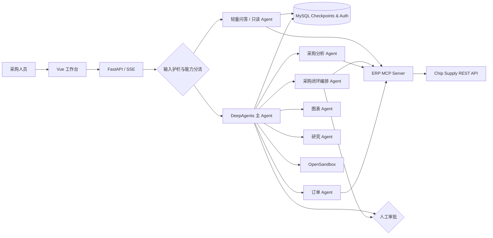

# ChipChain Procurement Agent

> 面向芯片供应链的企业级多智能体采购协作平台：让大模型不止“回答问题”，还能够在权限、安全与人工审批边界内完成查询、分析、比价、制图和采购执行。


## 项目亮点

- **端到端采购闭环**：将自然语言需求一次编排为物料匹配、库存核验、供应商准入、预算/交期/MOQ 校验、可解释推荐和采购单创建。
- **确定性智能比价**：AI 理解采购意图，版本化规则引擎负责硬约束、四维评分和稳定排序，输出可回放的 `decisionId`，避免模型自由改分。
- **多智能体协作**：主 Agent 负责任务规划，采购分析、订单处理、图表生成等专用 Agent 分工执行。
- **MCP 业务解耦**：通过 MCP 对接芯片物料、供应商、库存与订单服务，模型层与业务系统保持清晰边界。
- **可审计决策证据链**：写操作先进入 Human-in-the-Loop 审批，再由持久化指纹证据、跨实例原子认领、ERP 幂等和协调器约束；重启或扩容不会退回进程内快照。
- **安全隔离运行**：代码执行和文件处理下沉到 OpenSandbox，支持用户级沙箱复用、健康检查与故障熔断。
- **按能力分流**：输入护栏后，规则快速筛选，未确定请求由 deepseek-flash 限时分类；简短问答和白名单只读查询使用轻量 Agent，代码、文件、复杂分析和业务写请求保留沙箱及原审批流程，详见 [请求分流](docs/request-routing.md)。
- **生产化会话存储**：基于 LangGraph Checkpoint MySQL 保存运行状态，并独立维护认证、会话归属和前端展示消息。
- **输入安全治理**：使用 NeMo Guardrails 识别提示注入、越权访问、密钥索取和审批绕过等风险请求。
- **面向业务的可视化**：统一封装 26 类图表能力，支持参数校验、结构化产物回传和远端异常降级。

## 系统架构



## 技术栈

| 层次 | 技术 |
| --- | --- |
| Agent 编排 | DeepAgents、LangGraph、LangChain |
| 模型接入 | OpenAI-compatible Chat Model |
| 工具协议 | Model Context Protocol (MCP) |
| 执行隔离 | OpenSandbox、Code Interpreter |
| 安全治理 | NeMo Guardrails、HITL Approval |
| 服务端 | Python、FastAPI、SSE |
| 前端 | Vue 3、Vite |
| 持久化 | MySQL、LangGraph Checkpoint MySQL |

## 安装与启动

使用 Python 3.11–3.13（当前验证环境为 3.12）和 Node.js。在项目根目录运行：

```shell
python -m pip install -r requirements.txt
npm --prefix frontend install
```

依赖仅在 `pyproject.toml` 维护，`requirements.txt` 统一安装当前项目；
版本与已验证的 DeepAgents 0.7.18 环境对齐。技能脚本在沙箱中安装自己的依赖。
复制 `.env.example` 为 `.env` 并填写模型密钥、MySQL 凭据和 `ANALYSIS_MCP_URL`；
已有 `.env` 时直接编辑，避免覆盖已有凭据。博查联网搜索的 `BOCHA_API_KEY` 可选。
模型名称、参数和沙箱设置分别在 `src/agent/config.py`、`src/agent/backends/sandbox_setup.py` 中维护。

先启动 Java ERP 后端和 OpenSandbox Server，再在两个终端分别运行：

```shell
# ERP MCP 服务（项目根目录）
PYTHONPATH=src python -m mcp_server.server_main
# Web 前后端（项目根目录）
python start_web.py
```

Web 启动器使用后端 8090、前端 3000。独立的命令行交互入口为
`python src/test/agent_test.py`。MCP 工具的真实业务集成测试统一保留在
`tests/test_all_tools.py`，需要手动运行。已移除引用不存在 graph 对象的旧 LangGraph CLI 配置。

控制台默认输出启动摘要、沙箱生命周期和异常；在 `.env` 中设置 `LOG_LEVEL=DEBUG`
可查看 MCP 加载、沙箱命令执行和文件同步细节。第三方库默认仅输出警告和错误。
Web 和 CLI 使用同一份日志配置；`APP_ENV=production` 时同时追加写入 `erp_agent.log`。

## 采购闭环演示

在工作台点击“多 Agent 采购闭环”，或直接输入：

```text
帮我采购500片六轴惯性传感器，预算9000元，要求两周内交付。先核验库存和供应商，给出方案后创建采购单。
```

主 Agent 会把完整请求一次委派给 `procurement-orchestrator`。`procurement_compare` 统一查询物料、
库存和供应商，以 `supplier-score-v1` 规则先执行供应商状态、预算、交期、MOQ 等硬约束，再按
价格 35、交期 25、信用 25、库存与 MOQ 15 进行评分和稳定排序。结果包含决策 ID、规则版本、
分项分数、淘汰原因和解释文本；AI 只能解释，不能改写规则结果。

只有存在合格候选且用户明确要求执行采购时才会调用 `order_create`。写入前必须经过人工批准，
批准后还要校验持久化证据的完整指纹、有效期、规则版本和推荐字段，订单物料、数量或价格被篡改以及重复使用同一决策都会被拒绝。
ERP 只允许 Agent 创建“待审核”订单，并由服务端生成金额、创建人和系统字段。

比价会在返回 `decisionId` 前写入 MySQL；存储失败时明确返回不可下单结果。旧版本产生的
进程内临时 ID 不回填，也不能继续下单，必须重新执行 `procurement_compare`。ERP 调用发送后
若结果不明确，认领进入 `RECONCILIATION_REQUIRED`，协调器只查询有限次数；明确已有订单时
关联原订单，明确不存在且部署策略允许时才使用同一幂等键重试一次，不会释放后盲目重下。

登录后点击工作台右上角“决策证据”可查看候选解释、审批/订单生命周期和授权关联；策略回放
带有“模拟”标签，只读取已存来源事实并记录独立 provenance，绝不触发审批、认领或 ERP 写入。
完整 API 与可复制本地演示见 [决策证据 API](docs/decision-evidence-api.md) 和
[采购证据演示](docs/procurement-evidence-demo.md)。

版本化离线评测使用声明式场景、冻结 fixture 和隔离 runner，报告公开每项指标的分子、分母与
排除原因，并把安全回归置于延迟/成本改善之前。套件编写、基线策略、API 权限和可直接用于 CI 的
命令见 [采购决策评测系统](docs/evaluation-system.md)。

### 可复现评测结果（离线 / 测试证据）

以下结果来自 `default-procurement@1` 的冻结 fixture，不是线上准确率、实际采购节省、生产吞吐
或业务 ROI。零分母指标保持 `N/A`；本轮没有模型 token、价格或延迟样本，因此不发布相关数字。

| 模式 | 已测指标 | 分子 / 分母 | 导出报告 |
| --- | --- | ---: | --- |
| `rule-contract` | 硬约束断言通过 | 10 / 10 | [规则基线报告](docs/evaluation-results/rule-baseline.md) |
| `rule-contract` | 期望推荐一致 | 3 / 3 | [规则基线报告](docs/evaluation-results/rule-baseline.md) |
| `rule-contract` | 场景完成 | 6 / 6 | [规则基线报告](docs/evaluation-results/rule-baseline.md) |
| `workflow-safety` | 危险写入拦截 | 12 / 12 | [工作流安全报告](docs/evaluation-results/workflow-safety.md) |
| `workflow-safety` | 审批边界符合 | 6 / 6 | [工作流安全报告](docs/evaluation-results/workflow-safety.md) |
| `workflow-safety` | 场景完成 | 12 / 12 | [工作流安全报告](docs/evaluation-results/workflow-safety.md) |

规则套件[独立执行两次](docs/evaluation-results/rule-comparison.json)，候选运行见
[第二次规则报告](docs/evaluation-results/rule-candidate.md)。兼容比较与回归门禁结果见
[比较导出](docs/evaluation-results/rule-comparison.json)。工作流安全的
[4 个场景按套件配置各重复 3 次](docs/evaluation-results/workflow-safety.md)；订单写入只进入模拟器，
报告不能外推为生产安全事件拦截率。

从项目根目录复现并重生成同口径报告：

```powershell
$env:EVALUATION_E2E_OUTPUT_DIR = "$PWD\docs\evaluation-results"
& .\.venv\Scripts\python.exe -m pytest -q src/test/test_evaluation_end_to_end_mysql.py
```

把预算改为 4000 元可演示反例：两个候选总价分别为 7900 元和 8530 元，均被预算硬约束淘汰，
系统返回最低可行预算 7900 元且不会进入订单写入流程。

只读验证不会创建订单：

```shell
PYTHONPATH=src python scripts/verify_procurement_loop.py
```

界面按用户提问分组：一条问题对应一个助手答复区块，正文展示主助手最后的答复，
中间说明、子助手输出和工具调用收进可展开的“执行过程”。历史记录采用相同规则；
关闭执行过程展示时仍保留生成的图表。审批/补充信息流程继续由人工确认组件处理。


## 图表工具与验证

`create_unified_chart_tool` 将 26 种可视化按比较、趋势、分布、指标、层级、关系、地图
7 组组织，仍暴露一个 `generate_chart` 入口；`generate_spreadsheet` 和未知的新工具
保持独立。入口描述只保留常用数据形状，高级选项及 26 个 JSON 示例位于
[src/skills/analyis_chart_params.md](src/skills/analyis_chart_params.md)，按需读取。

参数依据启动时加载的原始 MCP schema 校验，并检查分组/堆叠、双轴长度、树深度、
节点引用及有限数值。兼容旧 treemap 单根对象；双轴系列标题补齐并去重，防止远端错误合并数据。
固定的结构图 dark 主题异常仅重试一次 default，并明确返回主题变化提示。
MCP 内容和结构化 artifact 通过 ToolMessage 保留；参数/远端错误返回 error 状态。

```shell
# 离线：真实 LangChain MCP 适配器、26 类型、105 场景、文档示例及异常边界
python -B src/test/test_chart_generator.py
# 真实：读取 ANALYSIS_MCP_URL，调用全部场景并下载、解码、检查图片（需要 Pillow）
python -B src/test/test_chart_live.py --output /tmp/chart-live
```

`src/test/fixtures/chart_mcp_tools.json` 是当前服务的 27 个原始工具 schema 快照；
`chart_scenarios.json` 保存合成测试数据。真实验证会检查 schema 是否变化，输出
`results.json` 和图片；任何远端或图片检查失败都会返回非零退出码。
受限环境可使用脚本的 `prepare-curl` / `verify-curl` / `verify-images` 分阶段模式，
新增兼容重试通过 `pending.curl` 执行；仅准备请求不算通过。

本次实测结果见 [图表验证报告](artifacts/chart-validation/report.json)：99/105 场景生成并验证图片，
包含 10 个明确提示改用默认主题的场景；剩余 6 个场景涉及 `pin_map` / `path_map`，
远端对其官方示例同样返回内部错误。修复或更换上游地图服务后需重新执行真实验证。

## 输入安全

通过 [NeMo Guardrails](https://github.com/NVIDIA-NeMo/Guardrails) 0.24.1 的
`self check input` 和 `check_async` 审查直接用户输入，只运行输入检查。
护栏通过 `src/agent/guardrails/` 下的配置文件管理：

- `config.yml`：独立审查模型、模型请求参数和启用的输入检查流程。
- `policies.yml`：禁止/允许的请求规则、输入长度、超时、拦截提示及直接回复流程名单。
- `prompts.yml`：审查提示词及严格的 `ALLOW` / `BLOCK` 输出约定。
- `rails/*.co`：可追加的 Colang 输入检查流程。

默认复用现有 DeepSeek 服务的地址和凭据，不需要 NVIDIA API Key。首次更新代码后重启后端，
之后修改 YAML 或 `.co` 文件将在下一次检查时生效。追加规则可编辑 `policies.yml`，
自定义输入流程可参考 `rails/business.co` 并在 `config.yml` 中启用。配置无效时返回 503，停止当前请求。

纯问候“你好”（允许首尾空白及结尾 `!` / `！`）通过安全检查后，由 `greeting` 输入流程
返回“你好！有什么可以帮你的吗？”，跳过业务模型并保存本轮问答。“你好，帮我查询订单”
等业务请求继续正常处理。匹配条件和回复文案在 `rails/business.co` 中维护。
直接回复流程须同时列入 `rails.input.flows` 和 `input_guard.direct_response_flows`；
运行时先执行全部安全检查，再执行回复流程，只有名单内流程的 `stop` 才作为正常回复。
这里未启用 NeMo 对话意图识别，单独添加 `user express greeting` 对话流程不会触发回复。

聊天消息、订单补充信息和 CLI 输入均在交给业务 Agent 前检查。审查策略覆盖提示注入、
索取密钥、跨用户数据访问、绕过审批及违法伤害指令；正常采购查询、下单、代码分析和
安全知识提问允许进入业务流程。输入默认最多 16000 个字符，可通过配置修改，不静默截断。
创建/修改订单的原有人工审批继续保留；恢复接口只接受补充文本或固定的 approve/reject
决策，不能夹带修改后的工具参数。

每条文本通常增加一次审查模型调用。只有明确的 `ALLOW` 才放行；拦截返回 HTTP 403，
格式错误返回 422，审查超时或服务异常返回 503，均不启动本次业务执行。
被拦截的新消息不会创建新会话或写入聊天记录；补充信息被拦截时保留待处理状态，
可以修改后重试。审查实例按请求隔离，不共享用户事件缓存。

此功能不检查网页/MCP 工具返回内容，也不是权限校验、数据隔离或人工审批的替代品。
模型可能出现误判或漏判；应使用实际业务与攻击样本评估后调整策略或审查模型。
离线测试使用真实 NeMo 执行流程及模拟审查结果，验证调用链和失败处理，不代表检测准确率：

```shell
python -B src/test/test_input_guard.py
```

## Web 登录与注册

运行 `python start_web.py` 后打开启动器显示的前端地址。首页提供登录、注册；
首次使用需注册，注册成功会自动进入工作台。用户名为 2–32 位字母、数字、
下划线或短横线，统一转为小写；密码为 8–128 位。没有默认账号或默认密码。

用户名与带随机盐的 scrypt 密码哈希保存到 MySQL，数据库不保存明文密码。
登录使用有效期 7 天的 HttpOnly Cookie，刷新页面可恢复登录；退出会撤销服务端
登录会话。聊天、沙箱绑定和记忆空间均使用后端从登录会话取得的用户名，Web API
不再接收客户端指定的 `user_id`。历史列表和会话读取、恢复、删除都检查用户归属。
已有的无归属历史保留在数据库中，不自动分配给任何新账号；CLI 示例账号不等同于 Web 账号。

本地开发使用默认 HTTP 设置即可。部署 HTTPS 时设置 `AUTH_COOKIE_SECURE=true`；
如果需要跨域访问，使用 `CORS_ORIGINS` 配置明确的可信前端地址（逗号分隔），不要使用 `*`。
前端默认通过同源 `/api` 代理请求。账号接口为 `/api/auth/register`、`/login`、`/me`、
`/logout`；写请求需包含 `X-Requested-With: DeepAgent` 请求头，前端已统一处理。

## 本项目的 MySQL 会话存储

Agent 会话、前端展示消息和沙箱绑定存储到MySQL，配置统一读取项目根目录
`.env`。默认使用 `localhost:3306`、用户 `root`、数据库 `agent_db`；密码通过
`MYSQL_PASSWORD` 设置，连接配置示例见 `.env.example`。MySQL 以项目 `.env` 为准；
模型及 MCP 配置允许同名进程环境变量覆盖 `.env`。芯链业务库 `chip_supply_db` 不受影响。

安装新增依赖并初始化（初始化脚本不启动模型、MCP 或沙箱）：

```shell
python -m pip install 'langgraph-checkpoint-mysql[aiomysql]==3.0.0'
python -B scripts/init_mysql.py
```

后端启动时也会自动初始化。`MYSQL_AUTO_CREATE_DATABASE=false` 时需要提前创建
数据库。连接、schema 初始化或权限错误会中止启动，不会自动退回内存保存会话。
采用 MySQL 8.0.19 及以上版本所需的语法；本项目针对新版 MySQL 不允许生成列
使用 MD5 的限制，调整了组件 3.0.0 的迁移步骤 15–17，直接创建普通哈希列、
回填数据并重建主键。最终表结构和运行时序列化仍与该组件一致，因此固定该组件版本。
组件说明：https://github.com/tjni/langgraph-checkpoint-mysql

基础聊天与执行状态使用 **9 张表**：前 4 张由检查点组件管理，后 5 张由项目管理。
决策证据与离线评测额外使用下列 14 张项目表；它们只做加法迁移，不改写已有 checkpoint 表。
新增账号表会在后端下次启动时自动创建：

| 表 | 关键字段 | 保存的内容                                            |
| --- | --- |--------------------------------------------------|
| `checkpoints` | `thread_id`, `checkpoint_ns`, `checkpoint_id`, `parent_checkpoint_id`, `checkpoint`, `metadata` | 每个会话/子图的状态快照结构、通道版本、父检查点、执行步骤等元数据。               |
| `checkpoint_blobs` | `thread_id`, `checkpoint_ns_hash`, `channel`, `version`, `type`, `blob` | 按通道和版本保存序列化状态值，包括消息等复杂对象。由组件还原，不能当普通 JSON 聊天记录编辑。 |
| `checkpoint_writes` | `thread_id`, `checkpoint_id`, `task_id`, `task_path`, `idx`, `channel`, `type`, `blob` | 各执行任务的中间写入、待处理结果及中断相关状态，供恢复流程使用。                 |
| `checkpoint_migrations` | `v` | 已执行的组件 schema 迁移版本                               |
| `session_display_messages` | `thread_id`, `message_index`, `message`, `updated_at` | 前端展示消息，每行一条 JSON，包含主/子 Agent 来源、工具参数、结果、图片链接等。   |
| `sandbox_registry` | `user_id`, `sandbox_id`, `created_at`, `updated_at` | 用户和 OpenSandbox 的绑定关系，`user_id` 为主键。             |
| `app_users` | `username`, `password_hash`, `created_at` | 注册账号及密码哈希。 |
| `auth_sessions` | `token_hash`, `username`, `expires_at`, `created_at` | 登录会话，只保存 Cookie 令牌的 SHA-256 哈希。 |
| `chat_threads` | `thread_id`, `user_id`, `created_at` | 会话与已注册用户的归属关系。 |

| 决策证据表 | 关键字段 | 保存内容 |
| --- | --- | --- |
| `procurement_decisions` | `decision_id`, `owner_user_id`, `evidence_fingerprint` | 不可变请求、来源事实和确定性结果；详细 JSON 可按保留策略清理。 |
| `procurement_decision_events` | `event_id`, `decision_id`, `event_type` | 审批、claim、ERP 结果、回放、导出和清理等追加事件。 |
| `procurement_decision_claims` | `decision_id`, `claim_token`, `idempotency_key`, `claim_state` | 跨 MCP 实例唯一 claim、歧义结果与终态。 |
| `procurement_replays` | `replay_id`, `decision_id`, `policy_version` | 只读回放清单、模拟结果和结构化差异。 |
| `app_capability_grants` | `username`, `capability`, `revoked_at` | `decision:audit`、`evaluation:view`、`evaluation:maintain` 窄权限。 |
| `decision_audit_actions` | `audit_id`, `actor_user_id`, `action` | 授权、导出、基线和保留操作审计。 |
| `procurement_decision_retention_holds` | `hold_id`, `decision_id`, `released_at` | 阻止证据按期清理的显式 hold。 |
| `procurement_decision_tombstones` | `decision_id`, `evidence_fingerprint`, `purged_at` | 清理后保留的最小存在性和完整性记录。 |

| 评测表 | 关键字段 | 保存内容 |
| --- | --- | --- |
| `evaluation_suite_versions` | `suite_id`, `version`, `content_fingerprint` | 已发布、不可原地修改的声明式套件版本。 |
| `evaluation_runs` | `run_id`, `suite_id`, `execution_mode`, `status` | 运行清单、队列 lease、取消请求、终态和聚合结果。 |
| `evaluation_cases` | `run_id`, `scenario_id`, `repetition`, `status` | 增量场景输入、实际输出、诊断、耗时和完成状态。 |
| `evaluation_assertion_results` | `run_id`, `scenario_id`, `assertion_index` | 客观断言的期望值、实际值、状态和诊断。 |
| `evaluation_baselines` | `suite_id`, `execution_mode`, `run_id` | 每个套件与执行模式唯一的已完成基线。 |
| `evaluation_audit_events` | `audit_id`, `actor_user_id`, `action` | 发布、运行、取消、基线和报告导出的授权审计。 |

决策表的列表查询按 `(owner_user_id, created_at)` 索引，生命周期事件按决策与时间索引，claim 对决策、claim token 和幂等键分别施加唯一约束。MCP 与评测 worker 在部署中应使用只授予这些表所需 `SELECT/INSERT/UPDATE` 的独立 MySQL 账号；不要复用数据库 root。`APP_CAPABILITY_BOOTSTRAP` 留空时全部窄权限默认拒绝，生产环境的赋权与撤销必须留下 `decision_audit_actions`。

`DECISION_EVIDENCE_RETENTION_DAYS` 控制详细请求、来源和结果的保留期；活动 hold 优先于清理。清理会先写 tombstone，再清空详细 JSON，不删除决策、订单或审计引用。备份时必须将决策表、事件、claim、回放、授权、hold 和 tombstone 放在同一个一致性快照中；恢复后先校验外键与 SHA-256 指纹，再恢复写流量。只恢复决策表而缺失 claim 可能导致无法安全判断订单是否已提交，因此不受支持。

“会话状态”可以理解为任务存档：用户提出什么需求、已有消息和工具结果、图运行到
哪一步，以及是否正在等待人工输入。相同 `thread_id` 可以读取该会话的存档，
`checkpoint_ns` 区分主图和子图，`checkpoint_id` 区分执行过程中的不同存档。
这里不保存模型内部的隐藏推理过程，也不代替 ERP 的采购订单表。

删除会话时，`checkpoints`、`checkpoint_blobs`、`checkpoint_writes` 和
`session_display_messages`、`chat_threads` 中该会话的数据在同一个事务内删除。展示消息的整批
替换也使用事务，插入失败会保留旧记录。应用表的时间使用 UTC。

`/memories/` 用户偏好和 `/persisted-skills/` 仍由 `InMemoryStore` 提供，未包含在
上述 MySQL 表之外，`/memories/` 用户偏好和 `/persisted-skills/` 仍由内存 Store 提供，进程重启会丢失这些内存数据。正常关闭应用仍会清理已加载的沙箱及绑定。

验证命令：

```shell
# 离线验证事务失败处理、初始化失败清理及新版 MySQL 的迁移兼容逻辑
python -B tests/test_mysql_storage.py
# 登录、注册、密码哈希、Cookie 会话与用户隔离验证
python -B tests/test_auth.py
# 使用 .env 连接本地 MySQL，创建并清理唯一命名的临时测试库
python -B tests/test_mysql_integration.py
```

集成验证覆盖真实建表、嵌套子图审批中断、断开重连后恢复、中文消息、展示历史、
沙箱绑定、事务回滚、会话删除、账号和登录会话持久化；不调用真实 LLM、ERP 写操作或 OpenSandbox。

## 环境准备性能

登录后的异步准备、沙箱健康缓存、预热池及用户 graph 复用的配置、资源成本和回退方式见 [环境准备运行说明](docs/runtime-preparation.md)。

本机 VM、自动化测试与只读对话的脱敏实测记录见 [环境准备优化验收](docs/runtime-preparation-validation.md)。
